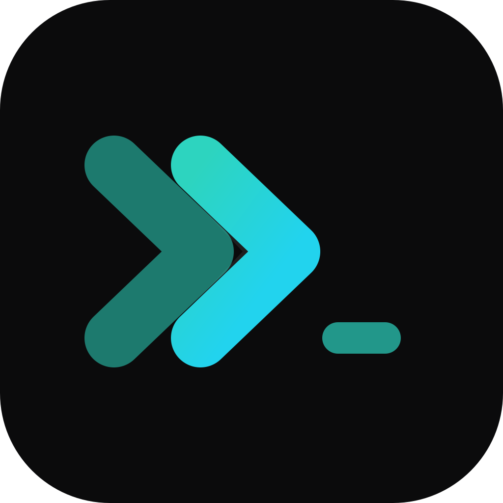

<p align="center"></p>

# Cadence

[](https://github.com/favcrm/cadence/actions/workflows/ci.yml)

Coordinate coding agents across terminals, from planning through verified delivery.

Cadence is an early Rust implementation of a local development-agent controller.
It is designed for a Codex or Claude PM coordinating Codex, Claude, Cursor and
Devin workers on one host, including terminals accessed over SSH.

**Development stage:** implementation in progress. Provider support is an
acceptance-tested capability, not a promise of universal session attachment.

## Install

To build from source with the board used in the quick start, install a recent
stable Rust toolchain via [rustup](https://rustup.rs), Node 22 and the pnpm
version declared in `ui/package.json`. Build the UI before installing Cadence:

```bash
pnpm -C ui install --frozen-lockfile
pnpm -C ui build
cargo install --path . --locked --features ui
```

For a CLI-only source build, `cargo install --path . --locked` needs just Rust.
That binary does not embed the board; serving it also requires a built UI and
`cadence ui start --dist /path/to/ui/dist`.

[Cadence 0.2.0](https://github.com/favcrm/cadence/releases/tag/v0.2.0)
is published as the stable local CLI release for Linux x86_64/ARM64 and Apple
Silicon macOS. The installer checks archive/binary digests and version; the release
includes build-provenance attestations:

```sh
curl -fsSL https://github.com/favcrm/cadence/releases/latest/download/install.sh -o install.sh
sh install.sh
"$HOME/.local/bin/cadence" --version
```

Linux daemon/board evaluation uses fresh, separate state. macOS supports CLI
installation/version checks only; setup, daemon and board are unsupported pending
CAD-315. Full clean-platform setup/backup acceptance remains open under CAD-317.

See [native installation](docs/INSTALL-AGENT.md) for supported platforms,
explicit pilot versions and provenance verification. The
[release record](docs/RELEASING.md) records the exact source, publication gates
and three-target anonymous installation evidence. New CLI builds default
`cadence update` to `https://api-v2.agenticos.hk`, without GitHub API access;
see the release record for advanced source overrides and verification requirements.

## Quick start

```bash
cadence setup                  # idempotent first run: state dir, tracker,
                               #  skill, daemon and board; reports provider CLIs
cadence daemon start           # detached controller
cadence skill install          # install the separate bundled guidance skills
cadence skill install company-outputs # workflow + business-document guidance only
cadence skill status           # per-skill files/content and provider-link status

cadence claude --alias pm --role pm       # named headless PM
cadence join pm devin --alias w1 --detach # named worker; keep this shell free
cadence dispatch CAD-1 --to w1 --reply-to pm # use an existing issue ID

cadence status                 # one-screen fleet overview
cadence ui status              # check the board started by setup
```

Open the board URL printed by `cadence setup`. Use `cadence ui run` only when
deliberately serving a board in the foreground without one already running.

`cadence --help` is the installed CLI reference. Start with
[project context](docs/START-HERE.md) for contracts and source ownership, or the
[contribution guide](CONTRIBUTING.md) for development and validation.

### Browse and update apps

Open **Apps → Explore apps**. Each card opens its full
details; installed apps keep local Open and operator Manage links even when
the public catalogue is unavailable. **Choose favorites** keeps quick links
on the Apps page and in the sidebar.

Standalone boards use `https://api-v2.agenticos.hk` for the public catalogue
by default. Set `AGENTICOS_BOARD_CATALOG_ORIGIN` only for a custom catalogue;
invalid explicit values are refused, not replaced with the default. Hosted
boards retain their internal catalogue route. These reads do not grant
installation, connection or execution approval.

An operator selects a published version, chooses **Review installation** or
**Review update**, inspects access and compatibility, then confirms the exact
package. **Other versions** permits an eligible older fresh install or an
intermediate update; existing installations never downgrade or auto-update.
Changing the selection discards the check. An unconfirmed result stays blocked
across navigation until **Check installation** reads it back; it is not retried.
Package installation does not approve connections or execution. Manual-source
operations remain on the installation's Manage page.

### Start a conversation

On a signed-in hosted board, open **Threads → Add** and choose **Direct** or
**Group**. Operators also have **Project** (project/fleet coordination) and
**Agent** (a thread with a live agent). Each mode has one creation action.

The member picker searches the complete current workspace by name, returning
at most 20 matches in a compact scroll area. Type to refine the results;
selected people remain above the list when the query changes. Use a selected
person's remove button to unselect them. Loading, unavailable and empty results
are distinct, and **Retry search** repeats a failed search without losing picks.
The server rechecks sign-in and live workspace membership on every search and
creation request; search results never grant access.

From **Agents**, choose **Message** to open that agent's conversation in
Threads. The recipient and any recorded work context stay visible. Delivery
labels describe the stored message state, not whether someone read it or
finished the work. A refused or uncertain send keeps the draft; check the
history before explicitly retrying an uncertain send.

**Home** remains the Assistant chat with its docked composer. The compact
**Since you left** summary expands into real issue links; the separate
**To do / Updates** rail keeps operator actions apart from information.
**Ask the Assistant** prefills a draft for inspection and editing, never
sends it automatically, and does not resolve the item.

An issue's **Overview** brings its current result, next action, output links
and verification together. A worker report is not independent review,
merge or deployment evidence. Activity, Conversation, Pull request and
Evidence remain the detailed views; feedback uses the existing conversation.

### Create minutes from a transcript

In an approved Meeting minutes installation, **New minutes** opens the content
form immediately. The app's declaration controls its field order and defaults:
app 0.2.3 puts the transcript first and makes the title optional. Paste the
transcript as one paragraph; native workflow inputs currently reject line breaks
and unsupported whitespace rather than silently rewriting the text.

If the app has no usable team, you can still enter the draft. **Set up app**
opens the existing team settings; **Back to draft** keeps the exact entered
text. Saving a valid team returns to the form without starting work. A configured
team is reused; its assignments and **Manage team** are under **App setup**.
Neither the form nor setup automatically chooses workers or providers.

**Review draft** prepares a scope-bound snapshot. Review its inputs and distinct
writer/reviewer assignments, then explicitly **Approve and start**. Setup alone
never creates, approves or dispatches a run. Draft text stays in this dialog's
memory, not browser storage: closing it, losing authorization or changing its
installation/context ends that draft. Recording and speech-to-text are not part
of this flow.
## What it gives you

- **Durable messaging** — every assignment, acknowledgement and result is a
  persisted message; delivery and reporting survive restarts.
- **Real endpoints** — owned tmux panes for TUI providers (Devin, Cursor,
  Claude `--tui`) and managed headless endpoints (Codex ws, Claude
  stream-json, Pi rpc via `join <pm> pi`); sessions resume by their
  native ids.
- **A git-backed tracker** — issues are Markdown files in a private repo
  (`~/pm`); every write is one commit, `issue log`/`blame` work from git alone.
- **Verified delivery** — workers report with `sha:`; reviewers bind a verdict
  to that exact head; `cadence audit` flags merges with no passing verdict.
- **A board** — read/write SPA + JSON API on loopback; one writer
  implementation behind CLI and API alike.
- **A sandbox** — `cadence dev up` (alias `sandbox`) runs a disposable second
  instance with its own state dir, tracker and port.

Task worktrees live under `.cadence/wt/` inside the repo checkout.

## Layout

```
src/        CLI, daemon and provider adapters (Rust)
ui/         the board (React + Vite; features/ + lib/ + ui/)
skills/     bundled cadence, business-documents and company-outputs guidance;
            additional checked-out agent-handover and sop-workshop skills
agents/     master-agent seed files
contracts/  versioned platform schemas and worked vectors
workflows/  reusable workflow templates
tests/      Rust integration suites, e2e harness, fixtures
scripts/    install, CI and review helpers
docs/       working docs — the context-manifest set stays tracked
            (docs/cadence/project-context.yaml indexes it)
```

## Company outputs

For proposals, quotations, reports and letters, give the drafting agent
[`skills/company-outputs/SKILL.md`](skills/company-outputs/SKILL.md).
It confirms the proposed solution before authoring, then applies one exact
Cadence template version: guidelines and reference files for an authoring
pack, or the existing quotation/invoice DOCX, calculation and export path.
There is no parallel company-profile registry. When a deliverable has a
visual standard, the skill conditionally loads shared document-design
guidance: inspect an authoring pack's actual references, keep a short style
guide in that pack's guidelines, and compare the authored output. A
quotation or invoice keeps the approved DOCX as its presentation
standard; a reference pack may inform review only. That guidance
adds no renderer and no PDF service. An authoring pack has no
DOCX source, prices or PDF export; the user prints or exports the final PDF.
`cadence skill install` installs
the three public guidance skills in separate directories under
`~/.agents/skills/`; the scoped `company-outputs` install also supplies
business-document guidance without refreshing the core Cadence protocol.
Company-private material, renderer scripts/images and trial data are not bundled.

Codex discovers the canonical directory; Claude/Cursor/Copilot use provider
symlinks. Existing real provider entries are preserved and reported as skipped,
not proof of seeing the bundled version. Status reports each skill's files and
links; a missing/stale reference is not a healthy install. Setup observes existing
partial/stale installs without rewriting them; explicit install is the refresh.
Daemon startup sync keeps the existing sandbox no-write guard.
Canonical bundled-file symlinks are refused before reading or writing them,
without rewriting their targets.

Discovery is provider-specific, not a live-context reload or hosted rollout.
Pi currently disables native skill loading, confined agents may lack access,
and remote workers need an accessible approved path or supplied guidance.
Do not change permissions or agent configuration to conceal those limits.

## Principles

- Preserve native session identity and visible terminal conversations.
- Separate terminal submission, explicit acknowledgement and verified work.
- Persist messages and events; stop on uncertain execution instead of replaying edits.
- Keep provider permissions intact and source state outside the repository.
- Review the exact worker revision before calling a task complete.

The release pipeline packages Linux x86_64/ARM64 and Apple Silicon macOS.
Packaging is separate from verified provider support on each platform.
Provider CLIs and their authentication remain
external dependencies; native terminal integration may require tmux.

## License

MIT. This project is not affiliated with provider vendors or other projects named Cadence.
