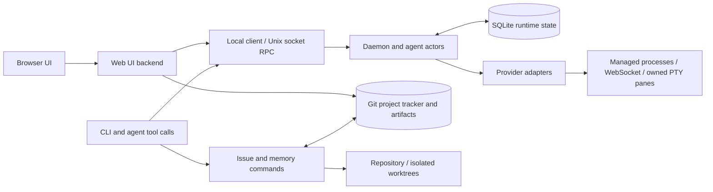

# Cadence architecture and code map

Code map updated 2026-09-26. This describes the source module
boundaries; future product behavior is in the [design proposal](design/DEVELOPMENT-TEAM.md).
Start with [project context](START-HERE.md) for scope and role-specific reading.

## System boundaries



The diagram is a responsibility map, not a claim that every CLI verb traverses
all these nodes. Some reads operate directly on tracker files; runtime actions
use the daemon. The board serves typed observations and task/project views.

Three storage concerns stay distinct:

- **Runtime SQLite:** agent/session identity, messages/events, job/task state,
  verdicts and monitor state. Delivery and lifecycle must reconcile across
  restarts; inspect the [RPC vocabulary](../src/proto.rs),
  [job handlers](../src/daemon/jobs_rpc.rs) and [storage](../src/store/mod.rs)
  for the contract at your source revision.
- **Git tracker:** project registration, issue files, comments, evidence refs
  and project memories. See [board](BOARD.md) for layout, writer and derived
  status rules. It is separate from the product source repository by default.
- **Product repository/worktrees:** code, versioned design/ADRs, tests and build
  artifacts. A tracker reference binds work to the real repo/branch/worktree;
  folder names alone are not ownership proof.

Ordinary daemon RPC replies buffer JSON formatting writes per connection and
flush after each newline-delimited response, including errors. This avoids a
socket syscall for each formatting fragment without delaying a complete frame.
Original-media transfers bypass that buffer: each binary send retains its
existing authority recheck and absolute deadline.

## Code ownership map

| Path | Responsibility / first read |
|---|---|
| [src/main.rs](../src/main.rs) | Binary entry point, process error/exit handling; delegates commands to CLI. |
| [src/cli/mod.rs](../src/cli/mod.rs), [src/cli/](../src/cli/) | CLI definitions, routing and launch composition; command behavior split into verb modules. |
| [src/cli/briefing.rs](../src/cli/briefing.rs) | Briefing modes, document and cloud bootstrap rendering, role carry-forward and opt-in AGENTS.md block. |
| [src/client.rs](../src/client.rs), [src/proto.rs](../src/proto.rs) | Local RPC client and protocol vocabulary. |
| [src/remote_auth.rs](../src/remote_auth.rs), [src/remote_enrollment.rs](../src/remote_enrollment.rs), [src/remote_result_outbox.rs](../src/remote_result_outbox.rs), [src/cli/remote_result.rs](../src/cli/remote_result.rs) | Distinct issuer sign-in, protected hosted child enrollment, immutable offline result custody and explicit sender CLI. The sender uses the issuer-bound record and original outbox pin; it does not enable a production gateway or grant daemon authority. See [issuer/enrollment contract](REMOTE-AUTH.md). |
| [src/daemon.rs](../src/daemon.rs), [src/daemon/](../src/daemon/) | Shared runtime coordination and central dispatch; area RPC handlers, identity, timers and actor lifecycle. |
| [src/store/mod.rs](../src/store/mod.rs), [src/store/schema.rs](../src/store/schema.rs), [src/store/](../src/store/) | SQLite schema/migrations and durable transitions, partitioned by domain; store tests live under `src/store/tests/`. |
| [src/backup/](../src/backup/) | Online-backup manifests, secret-scanned exports, restore with repository remap. |
| [src/adapter/mod.rs](../src/adapter/mod.rs), [src/adapter/registry.rs](../src/adapter/registry.rs) | Common adapter types and provider capability descriptors. |
| [src/adapter/](../src/adapter/), [src/adapter/pty/](../src/adapter/pty/) | Structured provider transports and owned terminal lifecycle. Check the registry for accepted combinations; screen classification is not provider approval. |
| [src/issue/](../src/issue/) | Project/issue files, start/dispatch/finish, history, report intake, relay and read-only retros. |
| [src/memory/](../src/memory/) | Proposal/curation CLI, scoped matching, bounded rendering and staleness observations. |
| [src/review.rs](../src/review.rs), [src/audit.rs](../src/audit.rs) | Revision-bound review evidence and merge/audit reconstruction. |
| [src/slots.rs](../src/slots.rs), [src/slots/persistence.rs](../src/slots/persistence.rs), [src/doctor/host/mod.rs](../src/doctor/host/mod.rs), [src/doctor/host/](../src/doctor/host/) | Slots: live build/test admission and coordination; persistence: serialization, strict commit, rejected-file evidence preservation and restart recovery. Doctor: partitioned host/session ownership/resource checks. |
| [src/session.rs](../src/session.rs), [src/worktree.rs](../src/worktree.rs), [src/proc.rs](../src/proc.rs) | Session/worktree operations and process helpers. |
| [src/ui.rs](../src/ui.rs), [src/overview.rs](../src/overview.rs), [src/overview/sources.rs](../src/overview/sources.rs), [src/overview/assembly.rs](../src/overview/assembly.rs), [src/overview/monitoring.rs](../src/overview/monitoring.rs) | UI: HTTP/API surface. Overview root: orchestration and shared read model; sources: bounded acquisition with owned fresh or borrowed reused snapshots; assembly: project/agent/actionable rows with contextual tracker/runtime/Git reads retained; monitoring: monitor health and durable alert projections. |
| [ui/src/features/](../ui/src/features/), [ui/src/lib/](../ui/src/lib/), [ui/src/ui/](../ui/src/ui/) | React feature screens, shared frontend libraries and UI primitives. |
| [tests/](../tests/) | Retired in CAD-1073 clean-slate. The integration suite and fixtures were removed; only the safety-floor binary remains. |
| [scripts/](../scripts/), [.config/nextest.toml](../.config/nextest.toml), [.github/workflows/](../.github/workflows/) | Review receipts, pinned test tooling and CI. |
| [docs/cadence/project-context.yaml](cadence/project-context.yaml), [docs/design/](design/), [docs/roles/](roles/) | Tracked context manifest, labelled design proposal and risk policy. Additional local working documents are not shipped contracts. |

## Work and evidence flow

A task has an objective and acceptance; its delivery message carries correlated
identity and revision evidence. Per-agent execution, durable task state and
provider/pane observations are different axes. An inbox endpoint stores
messages but has no worker actor. External collaboration agents are not
implicitly members of the native Cadence registry.

Implementation results go to independent review. A verdict names the reviewed
commit; changing the head invalidates its applicability. Combined-tree checks
address changes that landed in main after review. Recording merge evidence is
different from executing a GitHub merge. Source merge is different from a live
binary rollout and database migration.

Resource admission and provider quota are also different. A free build slot does
not prove provider allowance, and attaching/detaching a terminal does not prove
its provider process ended. Reclamation must prove ownership at action time.

### Bounded workflow preauthorization

Unattended authority is an explicit operator opt-in on an existing standalone
workflow, not permission for an agent to approve arbitrary plans or merges.
For a stored `ship` workflow with a `worker` input, the operator can bind one
render to a registered GitHub repository and file allowlist:

```sh
cadence workflow approve ship --project widgets --unattended \
  --repo acme/widgets --allow-path 'src/**' --input worker=dev-1 --ttl 3600
```

The master consumes that authority with
`cadence plan propose --project widgets --workflow ship --input worker=dev-1`.
The full template and rendered content must still match; changing wording,
inputs, the registered repository or worker does not admit a different plan.
One grant admits one plan. Repeating the same proposal recovers the same IDs,
not another dispatchable copy. Free-form files, app workflows and approvals
without `--unattended` keep their ordinary manual plan-approval path.

Grant lifetime defaults to 3600 seconds and is bounded to 1–86400 seconds.
Only the operator may renew the same grant with
`cadence workflow approve ship --project widgets --renew <grant-id> --ttl 3600`;
renewal preserves its immutable bounds and one-plan credit. Ordinary
`cadence workflow approve ship --project widgets` replaces the approval without
a grant and revokes future automatic authority. These commands require native
operator proof; a chat decision or client-supplied identity is not a grant.
Native renewal revisions order same-second changes. Reappending a captured
approval cannot resurrect a replaced grant or roll back a newer renewal,
including a deliberately shortened lifetime. This relies on intact native
history; it is not confinement against arbitrary same-UID database rewrites.

Issue semantics use deterministic JSON of the selected identity, plan,
dependency and body fields, with sorted dependency IDs. Escaped strings and
typed options/arrays keep multiline content and metadata boundaries unambiguous;
runtime-status changes remain excluded.

Canonical issue dispatch and its native revision/CI-fix turns recheck current
authority and use the recorded issue's repository and worker lane. Automatic
dispatch preserves daemon-authenticated origin through its self-RPC and
revalidates at the final enqueue gate, after blocking worktree/Git setup.
Bound kickoff and follow-up writes carry the server-derived grant deadline
into the queue transaction; connection/SQLite writer waits cannot extend it.
The tracker snapshot stays locked through enqueue; explicit operator
hand-dispatch and repair retain their existing authority. A done report alone
cannot start review: the owned queue turn must have completed
with that exact SHA. Unknown outcomes remain held for reconciliation; a known
failed provider turn stays failed and requires deliberate recovery, not a
fabricated successful result or a blind replay. A grant does not authorize
caller-authored job/task specifications or monitor dispatch; those unsupported
bound-job paths refuse rather than borrowing the issue's approval.

Before a bound repair produces another head, any earlier native merge request
must be proved removed: fresh same-head OPEN PR, no auto-merge request and no
queue entry. Active or unreadable state holds for operator inspection/removal,
not an automatic cancellation or retry. Grant→delivery locks serialize repair
and enqueue; an admitted repair clears its old standing PASS. Landing rechecks
the latest owned completion even after review, covering a crash between native
follow-up insertion and saving `Working`. Initial and follow-up instructions
require a final `SHA: <full head>` result line matching the done report.

Automatic landing requires a native independent exact-head PASS with explicit
`risk: auto` verdict frontmatter, applicable current CI and complete file/policy
evidence. Sensitive, protected, out-of-scope, unknown, deleted, renamed or
mode-changing work still needs an explicit operator decision. The latest
canonical `ci.yml` PR run supplies prequeue head feedback: a newer pending or
failed attempt cannot be hidden by an older success. Neither historical run
titles nor mutable `pull_requests[]` metadata prove current-base integration.

Automatic landing remains default-branch-only; approved integration targets use
ordinary delivery approval. Final integration authority comes from an enforced
merge queue with no bypass actors or mutation-identity bypass. Administrator-enforced
protection must bind the canonical `fmt`, `clippy`, `test`, `build` and `ui`
gates to GitHub Actions, plus `cross-build (required)` when that existing
aggregate is present. The trusted workflow must handle `merge_group`.
Missing settings or an unsupported gate inventory hold automatic landing for
operator setup; agents do not change repository rules. This reuses existing
CI jobs and the queue rather than adding a status publisher or secrets.
`--auto` enabled alone is not admission: a native `mergeQueueEntry` must be
observed and recorded before the loop calls the work enqueued.

Native admission and enqueue intents precede logical tracker writes and remote
mutation. ID directories reserve resources across interrupted admission; they
are not approval evidence. Identical files are not commit proof. An uncertain
enqueue is reconciled against the exact remote queue state, never blindly
repeated. Same-grant renewal does not rewrite the original intent's historical
expiry. Postmerge completion, including retries, must still have applicable
native authority, recorded queue admission and enforceable integration checks;
observed `MERGED` alone is insufficient. Revocation stops future daemon actions;
it does not itself guarantee cancellation of an already-issued remote queue request.

An `unattended_held` observation belongs to the operator. Its existing board
Details show the reason and inspection command; a matching owned-turn lane
fence and ticket hold share one escalation with both causes. Dismissal is not
resolution. Audit output distinguishes scoped workflow authority from a
per-head operator approval and does not claim a verified external attestation.
Implementation and isolated fixtures do not establish deployment, genuine
provider operation or completion of CAD-225's full acceptance.

## Memory implementation boundaries

`src/issue/dispatch.rs` matches accepted project memories, writes a bounded
lessons file and records included and withheld IDs. `src/cli/briefing.rs` adds accepted
project-wide rules to generated briefings. `--job` kickoffs are
daemon-templated and carry no lessons (CAD-194); do not assume every entry point
shares this retrieval behavior.

A memory record carries the daemon-authenticated proposer proof, one receipt
per independent reviewer (identity, digest, evidence) and PM finalization
receipts; `src/memory/mod.rs` refuses retrieval without two non-author passes
and a matching PM finalization; see the [memory implementation](../src/memory/mod.rs)
and [agent protocol](../skills/cadence/SKILL.md).
Freshness is a label from the last finalized verify; only an explicit `stale:`
mark withholds, and no citation re-check exists yet. Path-only matching depends
on recorded commit paths, so new work without commits can miss a relevant
lesson. The [development-team proposal](design/DEVELOPMENT-TEAM.md) describes
future learning behavior separately from these implementation guarantees.

## CLI errors and exit codes

The CLI prints one JSON error on stderr (`{"error", "kind", "code"?}`) and
exits by `kind`. The table lives in one place, `error::EXIT_TABLE`; the client
keeps every known wire kind, coded or not, and maps an unknown one to
`internal` (70). Only a self-clearing condition is `busy`; a legacy tracker
lock is a coded `gate` (exit 4, escalate). Codes 0, 1 and 2
predate it and stay verb-specific where noted.

| Exit | Kind | Meaning | Retry? |
|-----:|------|---------|--------|
| 0 | | success | |
| 1 | `unknown` | outcome unknown, or a failure with no kind; the verbs below also use 1 for "found a problem" | only after checking whether the side effect landed |
| 2 | `usage` | bad command line (clap), or the verb's own no-go (`doctor --host`, `audit`, `message` pending, `agent-uid provision`) | no, fix the command |
| 3 | `rejected` | invalid or disallowed request | no |
| 4 | `gate` | a gate refused the action; `code` `legacy_write_lock` means a legacy tracker lock only the rollout owner can clear | no: escalate, do not retry |
| 5 | `conflict` | stale revision; reload and redo the edit | no, reload first |
| 6 | `provider` | the provider explicitly rejected the request | no |
| 70 | `internal` | local failure (I/O, storage, daemon not reachable) | maybe, after fixing the cause |
| 75 | `busy` | transient contention (another live writer holds the tracker lock) | yes: at most 3 attempts with backoff (2s, 5s, 15s), same idempotency key, then report |

Verbs that wrap another program (`cadence test`, `build-slot`, attach) pass
that program's own exit code through. `--help` and `--version` exit 0.

## Validation and change impact

Use the [contribution guide](../CONTRIBUTING.md) and
[repository instructions](../AGENTS.md) for commands and admission rules.
After shared model changes, compile all Cargo targets: selected behavioral tests
can miss an uncompilable unit-test initializer. Keep fixtures isolated from
ambient environment and credentials. The pinned runner rejects empty selections;
record exact test counts and source/tree identity. Use the host suite lock and
bounded build concurrency, and verify the running daemon supports an admission
RPC before instructing workers to use it.

A generated graph can suggest affected modules, but review the actual diff and
contract. It cannot establish semantic correctness, reviewed authority, resource
ownership or a feature's deployed state.
